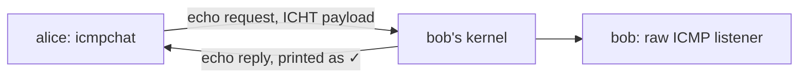

<p align="center">
  
</p>

<p align="center"><b>Terminal chat whose messages travel inside ICMP echo requests.</b> The peer's kernel echo reply is the delivery receipt, and AES-256-GCM is optional.</p>

<p align="center">
  <a href="https://github.com/Crank-Git/icmpchat/actions/workflows/ci.yml"></a>
  <a href="https://github.com/Crank-Git/icmpchat/releases"></a>
  
  
</p>

<p align="center">
  <a href="docs/protocol.md"><b>Docs</b></a> ·
  <a href="#install"><b>Install</b></a> ·
  <a href="#quick-start"><b>Quick start</b></a> ·
  <a href="https://github.com/Crank-Git/icmpchat/releases"><b>Releases</b></a>
</p>



## Why icmpchat

An echo request has a payload, and almost nobody looks at it. icmpchat puts the chat message there: you type at a `> ` prompt, the text rides an ICMP echo request to your peer, and their listener prints it.

The part I like is the acknowledgment. The peer's kernel answers every echo request on its own, so the reply that comes back is a free delivery receipt. The sender prints `✓` when it arrives and `✗ (no reply)` when it doesn't. Nobody crafts a reply by hand.

From there I added chunking for long messages, an optional `--key` for AES-256-GCM, and a relay for rooms with more than two people. The relay is also what gets macOS working, since the macOS kernel keeps incoming echo requests to itself.

## Requirements

- **Root to receive.** The listener needs a raw `ip4:icmp` socket. Without root, icmpchat says so and runs send-only.
- **Sending without root** works on macOS and on Linux hosts that allow unprivileged ICMP (`SOCK_DGRAM`) sockets. Otherwise the sender falls back to a raw socket, which needs root too.
- **ICMP between the hosts.** Many networks rate-limit or drop it.
- **macOS:** allow incoming requests in *System Settings → Network → Firewall → Options*, and use [relay mode](#relay) to receive.
- **Go 1.26.5 or later**, only if you build from source.

## Install

Grab a binary from [Releases](https://github.com/Crank-Git/icmpchat/releases): `icmpchat` for `darwin_arm64`, `linux_amd64` and `linux_arm64`, the relay for `linux_amd64` and `linux_arm64`, plus `SHA256SUMS`.

From source:

```sh
git clone https://github.com/Crank-Git/icmpchat.git
cd icmpchat
go build -o icmpchat .
go build -o relay ./cmd/relay
```

`go install` won't work. The module path is just `icmpchat`, which the Go module proxy can't fetch.

## Quick start

Try the sender on loopback first. On macOS this needs no root:

```sh
icmpchat --peer 127.0.0.1 --name alice
```

Type `hi there` and press Enter. Your kernel answers the echo request, so you get a `✓`. You'll also see `running in send-only mode; enable receiving with sudo.`, which is normal without root.

To chat between two hosts, run each side as root and point it at the other:

```sh
# on host A (192.0.2.20)
sudo icmpchat --peer 192.0.2.10 --name alice
# on host B (192.0.2.10)
sudo icmpchat --peer 192.0.2.20 --name bob
```

```
$ sudo icmpchat --peer 192.0.2.10 --name alice
icmpchat: chatting as "alice", peer 192.0.2.10
payload encryption: off
> hi there
✓
```

Incoming messages print on their own line above the prompt, with the local time:

```
14:03:07 bob: on you
```

Add `--key <passphrase>` on both sides to encrypt. A message sealed with the wrong key is dropped without a word, so if nothing shows up, check the passphrase first.

## Usage

```sh
icmpchat [--peer <ip> | --relay <ip>] [--name <nick>] [--room <name>] [--key <passphrase>]
```

| Flag | What it does | Default |
|---|---|---|
| `--peer` | Peer IP for direct mode. | none |
| `--relay` | Relay IP for room chat. Pass this or `--peer`, not both. | none |
| `--name` | Your display name. | `anon` |
| `--room` | Room to join through the relay. | `lobby` |
| `--key` | Passphrase. Turns on AES-256-GCM. | off |
| `--verbose` | Logs relay polls to stderr. | off |

Anything over the 1000-byte payload limit is split into chunks and reassembled on the other side. If a long message fails partway, you get `✗ (partial send: N of M chunks delivered; peer may see an incomplete message)`.

## Relay

Direct mode is one-to-one. The relay (`cmd/relay`) gives you rooms of any size and works when clients can't reach each other directly. It needs root. Run it on a host every client can ping:

```sh
sudo relay --addr 192.0.2.1
```

Then each participant joins through it:

```sh
sudo icmpchat --relay 192.0.2.1 --name alice --room lobby
```

Clients poll the relay about once a second, and the relay hands queued messages back as echo **replies**. Replies do reach raw sockets on macOS, which is why relay mode works there and direct mode can't receive.

| Flag | What it does | Default |
|---|---|---|
| `--addr` | The relay IP that clients pass to `--relay`. | best-effort detected |
| `--ttl` | Drops members quiet for longer than this. | `60s` |
| `--prune-every` | How often to drop quiet members. | `30s` |
| `--verbose` | Logs forwarded messages and poll drains. | `false` |

## How it works

Every payload starts with the 4-byte magic `ICHT`, so the listener ignores ordinary pings. The listener also drops echo replies and anything not from the peer. With `--key`, everything after the 5-byte `magic` + `ver` header is sealed, so a receiver can still filter without the key. The byte layout, the relay header and its flags are in [docs/protocol.md](docs/protocol.md).

## Documentation

| Page | What's there |
|---|---|
| [Protocol](docs/protocol.md) | Sender and listener sockets, the wire format, encryption, the relay's pull model and wire flags. |
| [Testing](docs/testing.md) | Every test level, what needs root, and the two-host script. |
| [Contributing](CONTRIBUTING.md) | Branches, CI and the project layout. |

## Development

```sh
gofmt -l .
go vet ./...
go test ./... -count=1
```

The e2e tests build the real binary and send to `127.0.0.1`. They skip on Linux without root. The full receive path needs two hosts and `sudo scripts/e2e_remote.sh`; see [Testing](docs/testing.md).

## Security

This is a toy transport, not a secure one.

- `--key` hides and authenticates the message content only. Anyone on the path still sees ICMP echo traffic between your hosts, plus the 5-byte header and, in relay mode, the room name.
- The key is `SHA-256(passphrase)` with no salt and no stretching. Use a long random passphrase.
- The listener and the relay run as root.

---

<sub>Part of <a href="https://github.com/Crank-Git#other-packets"><b>Other packets</b></a>.
Siblings: <a href="https://github.com/Crank-Git/sourceknock">sourceknock</a> ·
Built by <a href="https://github.com/Crank-Git">Crank</a></sub>
